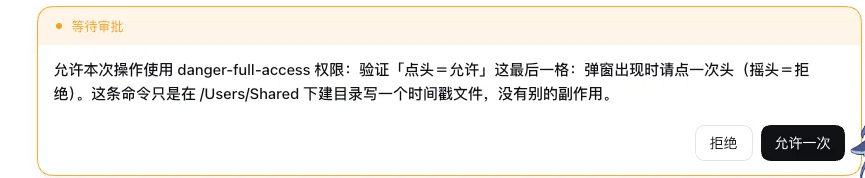
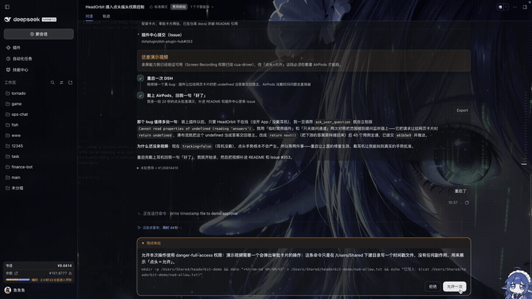
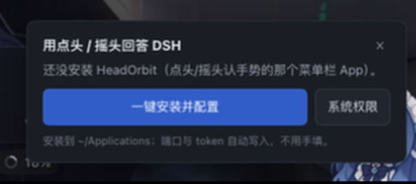

# dsh-airpod-control

用 **AirPods 的头部动作**回答 DeepSeek Harness 里的两件事，同一套手势：

| 场景 | 点头 | 摇头 |
| --- | --- | --- |
| **权限许可**（approval） | 允许（`allowed-once`） | 拒绝 |
| **模型提问**（`ask_user_question`，3 个以上选项） | 确认当前项 | 切到下一项 |

<p align="center">
  
</p>

手势由 [HeadOrbit](https://github.com/Cogria-AI/HeadOrbit)（AirPods 头部追踪的 macOS 菜单栏 App）识别，
经本机回环 HTTP 送到这个插件。插件在这里做了四件事：

- **自动装好 HeadOrbit**：插件自带安装器，页面右下角一张卡片就能下载、安装、写配置、启动、等心跳；
  装到 `~/Applications/HeadOrbit.app`，端口和 token 全自动，用户不用手填。
- **当审批回答者**：只有真有请求在等、且 HeadOrbit 在线时才认领，否则一行都不碰。
- **当提问回答者**：点头/摇头答题；3 个以上选项时摇头切换、点头确认。
- **手势答完撤掉网页卡片**：插件带一个浏览器半区，把已经被手势结算的那张卡片收掉，
  不会出现「点头同意了、卡片还挂在页面上」。

## 安装

还没发到 npm，先按源码装（两行）：

```bash
git clone https://github.com/fishcg/dsh-airpod-control.git ~/dsh-airpod-control
dsh plugin --profile desktop add link:~/dsh-airpod-control
```

> `--profile` 换成你实际在用的那个（桌面版默认 `desktop`，`dsh web` 是 `web`）。
> npm 发布之后这里会变成一行 `dsh plugin --profile desktop add dsh-airpod-control`。

装完重启 DSH，打开任意会话，右下角会出现「用点头 / 摇头回答 DSH」的卡片，点一下即可：

1. 下载 HeadOrbit（MIT，源码在 [fishcg/HeadOrbit-dsh](https://github.com/fishcg/HeadOrbit-dsh)）并装到 `~/Applications`
2. 把 DSH 的端口和共享 token 写进它的偏好，启动它
3. 等它开始轮询（说明链路通了）
4. 引导去「系统设置 → 隐私与安全性 → 动作与健身」给 HeadOrbit 打勾（**只能由系统弹窗授予**，所以这一步需要你点一下）

不想点卡片也可以一条命令：

```bash
curl -s -X POST "http://127.0.0.1:<port>/dsh-airpod-control/setup/run" | jq
```

共享 token 也不需要手填：配置里留空时会自动生成一份，落在 `~/.dsh-airpod-control/token`
（0600），安装器会把同一个值写进 HeadOrbit。

> 首次使用前请戴好 AirPods（Pro / 3 / 4 / Beats 等支持头部追踪的型号），并在 HeadOrbit 设置里确认「已连接」。

## 怎么用

1. 戴好耳机，HeadOrbit 菜单栏图标显示已连接。
2. 会话里出现审批卡片 / 提问卡片。
3. **点头** = 允许（审批）或确认当前选项（提问）；**摇头** = 拒绝或切到下一个选项。
4. 手势生效后卡片自动收起，工具继续跑。

手势和网页按钮**同时有效**，谁先到算谁的：插件认领请求时也调用 `next()`，卡片照常渲染，
你在页面上点「允许」和做一个手势是在赛跑。没有回答者时 DSH 本来就是 fail closed，本插件不改变这个性质。

## 演示：点头 = 允许

下面是一段 5 秒的真机录屏——审批卡片弹出后点一次头，卡片自动收起、命令随即执行（摇头就是「拒绝」）：



[下载 mp4 原片](docs/demo.mp4)

## 截图

首次打开时右下角会自动出现安装卡片（左）；装好后审批卡片长这样（右）：

| 一键安装引导 | 审批卡片 |
| --- | --- |
|  |  |

## 配置

在 profile 的 `cordis.patch.yml` 里覆盖（都有安全默认值）：

| 键 | 默认 | 说明 |
| --- | --- | --- |
| `enabled` | `false` | 关着的时候什么都不注册，等于没装 |
| `token` | `''` | 共享密钥。留空则自动生成到 `~/.dsh-airpod-control/token`（0600）；非空时以配置为准。请求需带 `X-HeadOrbit-Token` |
| `nodAllows` | `true` | `false` 则反过来：摇头＝允许、点头＝拒绝 |
| `claimQuestions` | `'auto'` | `'off'` 则完全不接模型的提问，只回答权限许可 |
| `timeoutMs` | `600000` | 审批没人理时的兜底（按拒绝结算） |
| `questionTimeoutMs` | `600000` | 提问没人理时的兜底（工具返回 pending，不是跳过） |
| `requireHeadOrbit` | `true` | `false` 时不看心跳、永远抢答（只建议自测时用） |
| `aliveWindowMs` | `6000` | HeadOrbit 多久没轮询就当它不在线 |
| `debounceMs` | `200` | 两次手势之间的最小间隔 |

## 端点

全部挂在 `/dsh-airpod-control` 前缀下，复用宿主已有的 webServer 路由（因此只听 127.0.0.1）。
除 Host / 同站检查之外，都需要 `X-HeadOrbit-Token`；标了**免 token** 的那几个是给浏览器半区用的，
只读且不含会话内容。

| 方法 | 路径 | 用途 |
| --- | --- | --- |
| `GET` | `/state` | `{ waiting, kind, label, question?, deadlineAt, canAnswer, headOrbit, ... }`，HeadOrbit 靠它决定要不要发手势，同时它本身就是心跳 |
| `GET` | `/health` | 自检：`{ ok, hasToken, hasApprovalAnswerer, hasQuestionAnswerer, headOrbitAlive, answered, ignored }`（不回报 token 本身） |
| `GET` | `/events` | 最近的事件流水，排查用 |
| `GET` | `/last-decision` | **免 token**：最近一次手势/按键结算了哪个请求（浏览器半区据此撤卡片） |
| `GET` | `/cursor` | **免 token**：当前光标落在第几项（只回序号与那一项的文字） |
| `GET` | `/setup` | **免 token**：`{ app: { installed, running }, bridge, alive, tokenConfigured, last, running }` |
| `POST` | `/setup/run` | **免 token**：下载 + 安装 + 写配置 + 启动 + 等心跳；`{ reinstall?: true }`，返回逐步状态 `steps[]` |
| `POST` | `/setup/motion` | **免 token**：打开系统设置的「动作与健身」隐私页 |
| `POST` | `/gesture` | `{ "gesture": "nod" \| "shake", "ttlMs": 2000, "requestId"?: "q1" }` |
| `POST` | `/answer` | `{ "decision": "allow" \| "reject" \| "select:N", "requestId"?: "q1" }`，没有耳机时的等价入口 |

`/state` 里 `kind` 是 `"approval"` 或 `"question"`；等提问时 `question` 会带上题目与选项
（`{ requestId, label, count, questions, deadlineAt, cursor }`）。浏览器半区拿 `question.cursor`
在网页卡片上把「现在点头会选中哪一项」圈出来。带 `requestId` 的调用是网页卡片回的答案，
id 对不上会得到 `409 { stale: true }`。

```console
$ curl -s -H "X-HeadOrbit-Token: $TOKEN" http://127.0.0.1:$DSH_WEB_PORT/dsh-airpod-control/health
{"ok":true,"plugin":"dsh-airpod-control","version":"0.2.0","hasToken":true,"hasApprovalAnswerer":true,"hasQuestionAnswerer":true,"headOrbitAlive":true,"headOrbitWindowMs":6000,"waiting":false,"waitingKind":null,"answered":3,"ignored":0}
```

端口就是 DSH 自己的 GUI 端口（`dsh web` 启动时打印的那个）；插件不开新端口。

## 安全性（值得说清楚）

- 不自己开端口：复用宿主已有的 webServer 路由，因此天然只听 127.0.0.1。
- 必须有共享密钥：token 为空时自动生成一份（0600），并要求请求带 `X-HeadOrbit-Token`，
  所以本机别的进程即使能访问这个端口也伪造不了答案。
- `/setup*` 是免 token 的（浏览器拿不到 token），因此只接受**回环 Host + 同站请求**；
  它做的都是固定参数的本机动作（`defaults` / `ditto` / `open`），请求内容不会进 shell。
  装上之后任何本机进程仍然可以调它重装 —— 这在能读你用户目录的进程面前不算新增权限。
- 只回答「正在等待中的那一次请求」：过期的、没有请求在等的、手势与映射不符的，一律忽略；
  一次请求只会被结算一次。
- 没有回答者时 DSH 本来就会 fail closed，本插件不改变这一点。

## 测试

```bash
cd dsh-airpod-control
node --test test/plugin.test.js     # 45 个用例，手写假宿主，不需要真 DSH
```

覆盖：审批允许/拒绝/超时/取消、提问（两选项与多选项光标）、请求竞态、token 与 Host/同站校验、
自动生成 token、`/setup` 状态、卡片撤除的依据（`/last-decision`）、手势去抖等。

## 已知边界

- 只支持 macOS（HeadOrbit 是 macOS 菜单栏 App，用 CoreMotion 读 AirPods）。
- 需要支持头部追踪的耳机；没有耳机时插件不会认领任何请求，行为与未安装一致。
- 手势识别由 HeadOrbit 负责，阈值可在 App 里按自己的幅度校准（点头约 12°、摇头约 19°）。
- 插件和网页卡片是竞态关系：两边同时给答案时，先到的那个生效。
- 安装器下载的是 `fishcg/HeadOrbit-dsh` 的 latest release（ad-hoc 签名、未公证），
  安装后会自动去掉 quarantine 属性；签名/公证版本后续再补。
